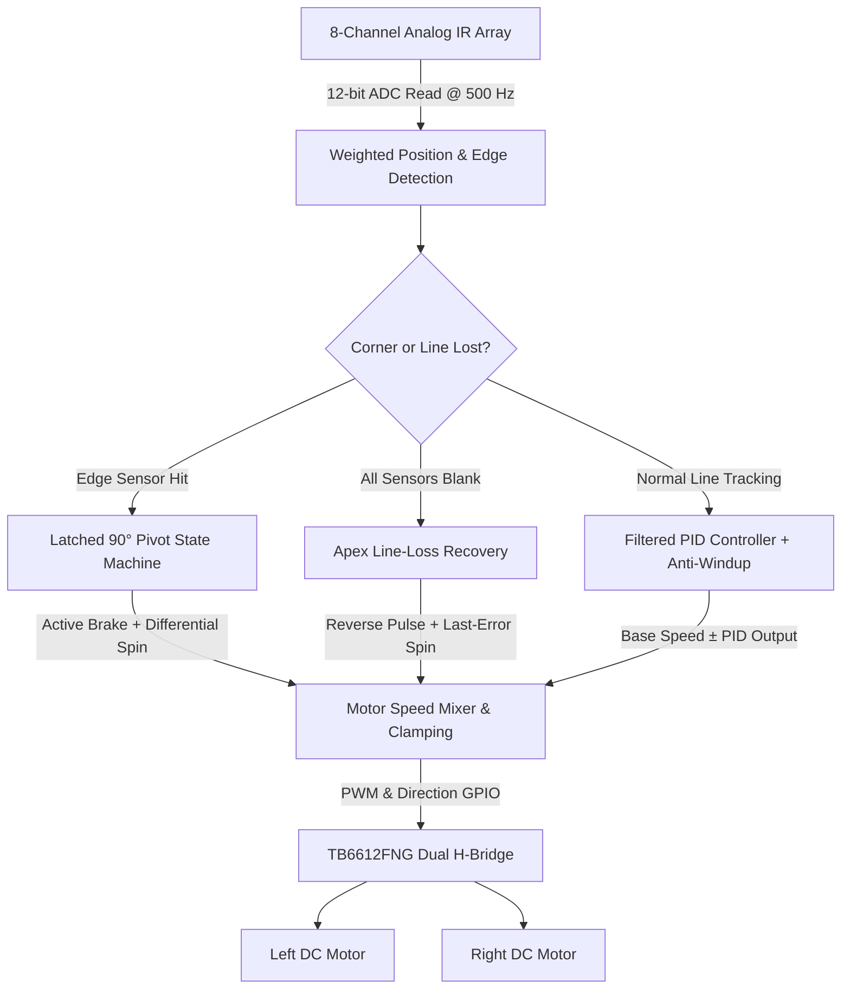

# High-Speed ESP32 PID Line-Following Robot (500 Hz Control Loop)

An autonomous differential-drive line-following robot powered by an **ESP32**, an **8-channel analog IR sensor array**, and a **TB6612FNG** dual H-bridge motor driver. 

Engineered for competitive track racing, this firmware combines a **500 Hz filtered PID controller** for smooth high-speed straightaway tracking with a **latched state-machine override** for crisp, zero-overshoot 90-degree turns and apex recovery.

---

## System Architecture & Control Flow



---

## Key Engineering Features

1. **Deterministic 500 Hz Control Loop (`2 ms` period)**:
   - Decouples high-frequency motor control (`2 ms`) from non-blocking UART debug telemetry (`100 ms`), ensuring consistent derivative (`dt`) calculations without serial print latency.
2. **Weighted Centroid Error Calculation**:
   - Assigns symmetric spatial weights `[-3.5, -2.5, -1.5, -0.5, +0.5, +1.5, +2.5, +3.5]` across the 8 IR channels to compute a continuous sub-sensor position error (`-3.5` to `+3.5`).
3. **Low-Pass Filtered Derivative & Integrator Anti-Windup**:
   - Applies a first-order IIR filter (`D_FILTER_ALPHA = 0.6`) to the derivative term to prevent ADC quantization noise from inducing motor jitter.
   - Clamps integral accumulation whenever output saturates (`±1.5 × BASE_SPEED`) so the robot does not overshoot when exiting long curves.
4. **Latched 90-Degree Sharp Corner Override**:
   - Standard PID loops struggle with instantaneous 90° intersections because the robot's forward momentum carries the sensor bar past the line before the derivative term reacts.
   - When outer edge sensors (`0, 1` or `6, 7`) trigger exclusively, the controller briefly applies an **active brake (`12 ms`)** to kill forward inertia, latches into a full-power differential pivot (`±TURN_BOOST_SPEED`), and counter-brakes the instant inner sensors (`2–5`) reacquire the line.
5. **Apex Line-Loss Recovery**:
   - If the chassis overshoots an acute hairpin and loses the line for `8` consecutive samples (`16 ms`), it executes a brief `60 ms` reverse pulse followed by an in-place spin in the direction of the last recorded `lineError` polarity.

---

## Hardware & Pinout

### Components
- **Microcontroller**: ESP32 DevKit V1 (30/38-pin)
- **Sensor Array**: 8-Channel Analog IR Reflectance Sensor Bar (with IR emitter enable pin)
- **Motor Driver**: TB6612FNG Dual DC Motor Driver
- **Actuators**: 2x High-RPM N20 / BO DC Gear Motors + Differential Chassis
- **Power**: 2S/3S LiPo Battery + Buck Converter (5V/3.3V logic rail)

### ESP32 Wiring Table

| Peripheral | Pin Name | ESP32 GPIO | Notes |
| :--- | :--- | :--- | :--- |
| **TB6612FNG** | `AIN1` | `GPIO 17` | Left Motor Direction 1 |
| **TB6612FNG** | `AIN2` | `GPIO 18` | Left Motor Direction 2 |
| **TB6612FNG** | `PWMA` | `GPIO 16` | Left Motor Speed (PWM) |
| **TB6612FNG** | `BIN1` | `GPIO 21` | Right Motor Direction 1 |
| **TB6612FNG** | `BIN2` | `GPIO 13` | Right Motor Direction 2 |
| **TB6612FNG** | `PWMB` | `GPIO 19` | Right Motor Speed (PWM) |
| **TB6612FNG** | `STBY` | `GPIO 22` | Driver Enable (`HIGH`) |
| **IR Array** | `IR_EN` | `GPIO 23` | IR Emitter Control (`HIGH`) |
| **IR Array** | `S0 – S7` | `14, 27, 26, 25, 33, 32, 35, 34` | Analog Inputs (Left to Right) |

> **Note on ESP32 ADC2 Pins:** `GPIO 14, 25, 26, 27` belong to `ADC2`. Because Wi-Fi is unused in this firmware, `ADC2` operates reliably at full 12-bit resolution (`0–4095`).

---

## PID & Cornering Tuning Guide

All tunable constants are isolated in `src/config.h`. If you modify the chassis weight, battery voltage, motor RPM, or track surface, tune the parameters in the following sequence:

### Step 1: Sensor Threshold Calibration
- Place the sensor bar over the track background and over the line.
- Adjust `RAW_LINE_THRESHOLD` (currently `3700`) midway between white and black ADC readings.
- Set `LINE_READS_HIGH = true` for a black line on a white track, or `false` for a white line on a dark track.

### Step 2: Baseline Speed & Proportional Gain (`Kp`)
1. Temporarily set `Ki = 0`, `Kd = 0`, and lower `BASE_SPEED` to `130`.
2. Increase `Kp` until the robot tracks gentle curves firmly without sluggishness, stopping just when minor oscillation begins around the centerline.

### Step 3: Derivative Damping (`Kd`)
1. Increase `Kd` (typically `1.2×` to `2.0×` of `Kp` at `dt = 2 ms`) to dampen the oscillation introduced by `Kp`.
2. A well-tuned `Kd` makes the robot snap onto straightaways without fishtailing. If the motors buzz or vibrate on straight lines, lower `Kd` or reduce `D_FILTER_ALPHA` (e.g., from `0.6` to `0.4`).

### Step 4: Steady-State Trim (`Ki`)
1. Keep `Ki` very small (`0.5` – `2.0`). It compensates for minor motor asymmetry or battery voltage sag during long sweeping curves. Too much `Ki` causes slow oscillation.

### Step 5: Scaling Speed & 90° Corner Parameters
Once stable at low speed, gradually raise `BASE_SPEED` (`190`) and `MAX_SPEED` (`230`), then tune the cornering overrides:

| Parameter | Current Value | Effect When Increased |
| :--- | :--- | :--- |
| `TURN_BOOST_SPEED` | `220` | Faster chassis rotation on 90° corners; too high may skip past thin lines. |
| `MAX_TURN_DURATION_MS` | `350 ms` | Allows longer pivot search before declaring `lineLost`. |
| `TURN_COOLDOWN_MS` | `80 ms` | Prevents false double-triggers immediately after exiting a 90° turn. |
| `REVERSE_TIME_MS` | `60 ms` | Stronger backward kick when overshooting acute hairpins. |

---

## Telemetry Output

Open the Serial Monitor at **`115200` baud** to view live `10 Hz` diagnostics:
```text
Pos:-0.50   Out:-45.00   L:145   R:230   TurnL:0   TurnR:0   Lost:0
```
- **`Pos`**: Weighted line error (`-3.5` = far left, `0.0` = centered, `+3.5` = far right)
- **`Out`**: Computed PID correction value
- **`L` / `R`**: Final constrained PWM values sent to Left and Right motors
- **`TurnL` / `TurnR` / `Lost`**: Active state flags for debugging corner triggers